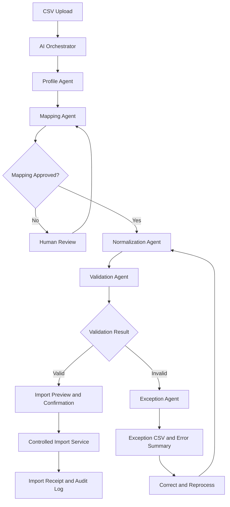

# Business Requirements Document (BRD): Customer Data Cleaner

**Project 4 — Customer Data Onboarding & Validation Platform**  
**Version:** 1.0 (Draft)  
**Date:** October 2026

## 1. Executive Summary

The Customer Data Cleaner transforms inconsistent customer CSV files into a standardized, validated dataset that can be safely imported. It helps organizations reduce manual data preparation, improve data quality, accelerate customer onboarding, and make import failures transparent and actionable.

The proposed workflow uploads, maps, normalizes, validates, and imports customer records. Invalid records are routed to an exception file with error details and corrective guidance.

The product also provides a portfolio case study demonstrating AI agent orchestration, enterprise data workflows, validation logic, exception handling, and human-in-the-loop design.

## 2. Business Problem and Opportunity

Organizations receive customer data from multiple systems, vendors, and business units. These files may contain inconsistent field names, different date formats, duplicate customer IDs, missing mandatory fields, and invalid values.

| Current challenge | Business impact | Proposed solution |
|---|---|---|
| Inconsistent column names | Manual mapping and onboarding delays | AI-assisted field mapping |
| Different formats for the same data | Failed imports and inconsistent reporting | Standardization and normalization |
| Duplicate customer IDs | Duplicate or conflicting customer records | Duplicate detection and configurable rules |
| Missing mandatory fields | Rejected or incomplete customer records | Required-field validation |
| Errors discovered after import | Rework and downstream data-quality issues | Pre-import validation |
| Unclear reasons for rejection | Slow issue resolution | Downloadable exception file with actionable errors |

**Business opportunity:** Create a repeatable onboarding pipeline that makes data quality visible before import, reduces avoidable manual work, and gives operations teams control over how questionable records are handled.

## 3. Business Objectives and Success Metrics

The following targets are proposed for the MVP and should be validated during pilot testing.

| Objective | Proposed success metric | Initial target |
|---|---|---:|
| Reduce manual effort | Reduction in time spent preparing files | 40% |
| Improve data quality | Records passing validation after correction | ≥95% |
| Improve mapping efficiency | Fields mapped automatically or accepted with minimal edits | ≥80% |
| Prevent duplicate imports | Detected duplicates blocked before import under configured rules | 100% |
| Improve error transparency | Invalid records with actionable error reasons | 100% |
| Improve processing reliability | Valid records processed successfully | ≥99% of eligible records |
| Support traceability | Processing runs with auditable outcomes | 100% |

These are **proposed product goals, not measured results**. Actual baselines and targets should be agreed upon with business stakeholders.

## 4. Scope

### 4.1 In Scope — MVP

- Upload CSV files and inspect their structure.
- Profile columns, data types, missing values, and potential duplicates.
- Map source columns to a predefined customer schema.
- Normalize supported formats and values.
- Validate mandatory fields, data types, and uniqueness rules.
- Separate valid records from invalid records.
- Generate downloadable exception files with error details.
- Preview results and import eligible records.
- Display processing status, counts, and a run summary.
- Maintain an audit trail of processing outcomes.

### 4.2 Out of Scope — Initial Release

- Real-time synchronization with every CRM or ERP.
- Autonomous correction of ambiguous customer identities.
- Merging customer records across external systems.
- Complex master data management and entity resolution.
- Unreviewed AI-generated changes to source data.
- Advanced predictive analytics and data-quality forecasting.

## 5. Stakeholders and User Personas

| Stakeholder | Responsibility / need |
|---|---|
| Business owner | Defines onboarding goals and success metrics |
| Data operations analyst | Uploads files, reviews mappings, fixes errors |
| Data steward | Defines canonical schema and data-quality rules |
| System administrator | Configures access, schemas, and import settings |
| Engineering team | Builds orchestration, processing, and integrations |
| Security and compliance | Reviews access controls, retention, and auditability |

### Primary Persona: Customer Data Operations Analyst

**Goal:** Import accurate customer records without spending hours manually cleaning spreadsheets.

**Pain points:**
- Unfamiliar column names.
- Inconsistent formats.
- Duplicate IDs.
- Unclear validation failures.
- Repeated file uploads.

**Needs:**
- Explainable mapping suggestions.
- A clear validation summary.
- Record-level error details.
- Easy correction and reprocessing.
- Confidence that invalid data will not be imported.

## 6. End-to-End Workflow

1. **Upload CSV:** Inspect file structure and confirm source data.
2. **Profile data:** Identify columns, data types, missing values, and anomalies.
3. **Map fields:** Suggest source-to-target mappings and request review when uncertain.
4. **Normalize data:** Standardize supported formats using approved transformation rules.
5. **Validate records:** Check required fields, formats, uniqueness, and business rules.
6. **Route outcomes:**
   - **Valid records:** Preview and import eligible records.
   - **Invalid records:** Generate an exception file and allow correction.
7. **Reprocess:** Re-upload or reprocess corrected exceptions.

### Important Processing Rule

The workflow must not silently discard invalid records or treat successful normalization as proof that a record is valid. Validation must run against the target schema and configured business rules before import eligibility is determined.

## 7. Functional Requirements

Priority definitions: **P0** = required for MVP launch; **P1** = important enhancement; **P2** = future improvement.

| ID | Requirement | Priority |
|---|---|---|
| FR-01 | Upload a supported CSV file and display its name, size, and row count. | P0 |
| FR-02 | Detect delimiters, headers, column types, blank values, and malformed rows. | P0 |
| FR-03 | Profile the dataset and summarize potential quality issues. | P0 |
| FR-04 | Suggest mappings between source fields and the canonical customer schema. | P0 |
| FR-05 | Allow users to edit, confirm, and save field mappings. | P0 |
| FR-06 | Flag ambiguous or low-confidence mappings for human review. | P0 |
| FR-07 | Normalize supported dates, email casing, whitespace, and configured formats. | P0 |
| FR-08 | Preserve source values and record transformation history. | P0 |
| FR-09 | Validate required fields, data types, formats, and duplicate IDs. | P0 |
| FR-10 | Display validation errors at dataset and record level. | P0 |
| FR-11 | Separate valid and invalid records before import. | P0 |
| FR-12 | Generate an exception CSV with original values, row identifiers, and error codes. | P0 |
| FR-13 | Preview eligible records and require confirmation before import. | P0 |
| FR-14 | Display import results, failure counts, and downloadable outputs. | P0 |
| FR-15 | Allow users to correct exceptions and reprocess them. | P1 |
| FR-16 | Save reusable mapping templates for recurring source files. | P1 |
| FR-17 | Support configurable schema versions and validation rules. | P1 |
| FR-18 | Provide processing history and audit logs. | P0 |
| FR-19 | Support larger files through asynchronous processing and status updates. | P1 |
| FR-20 | Provide role-based access and configurable retention policies. | P0 |

## 8. Business Rules

The following rules establish the initial data-quality contract. They should be configurable where business requirements differ.

| Rule ID | Business rule | Expected behavior |
|---|---|---|
| BR-01 | Customer ID is mandatory. | Reject records with missing or blank IDs. |
| BR-02 | Customer IDs must be unique within the import batch. | Flag all records involved in a duplicate conflict. |
| BR-03 | Required fields must meet target-schema constraints. | Route records with missing mandatory values to exceptions. |
| BR-04 | Email must match the configured format validation. | Flag invalid email values; do not invent replacements. |
| BR-05 | Dates must be parseable using an explicit or confirmed format. | Normalize valid dates; flag ambiguous or invalid dates. |
| BR-06 | Source-to-target mapping must be confirmed when ambiguous. | Block processing until required mapping decisions are resolved. |
| BR-07 | Normalization must follow approved transformation rules. | Preserve original values for audit and troubleshooting. |
| BR-08 | Only records that pass required validation may be imported. | Block invalid records from the import operation. |
| BR-09 | Reprocessing must not unintentionally create duplicate records. | Use stable identifiers and idempotent import controls where supported. |
| BR-10 | Each failed validation must be traceable. | Provide a record identifier, rule identifier, and human-readable reason. |

**Duplicate handling decision:** If two records share the same customer ID, flag both by default rather than arbitrarily choosing one. A future version may support approved merge or survivorship rules.

## 9. AI Orchestration and Agent Responsibilities

The proposed architecture uses five specialized agents coordinated by an orchestrator. AI is best suited to interpretation and recommendations; deterministic code should enforce critical data-quality and import rules.

### 9.1 Agent Responsibilities

| Agent | Input | Output | Control |
|---|---|---|---|
| Profile Agent | Uploaded CSV | Schema profile and quality findings | Report observations without modifying source data |
| Mapping Agent | Source profile, target schema | Field mappings and confidence indicators | Human approval for unresolved ambiguity |
| Normalization Agent | Confirmed mappings and rules | Standardized records and transformation log | Never silently guess ambiguous values |
| Validation Agent | Normalized records and rules | Pass/fail outcomes and error codes | Enforce rules through deterministic checks |
| Exception Agent | Validation results and source rows | Exception CSV and error summary | Preserve original values and identify every failure |

### 9.2 Orchestrator Requirements

- Execute agents in dependency order and pass structured outputs between stages.
- Maintain job status: `Uploaded → Profiled → Mapping Review → Normalized → Validated → Import Ready → Completed`.
- Add alternative states for `Needs Review`, `Failed`, `Cancelled`, and `Partially Imported`.
- Pause execution when a required user decision is missing.
- Retry transient processing failures without duplicating import side effects.
- Persist run IDs, agent versions, schema versions, rule versions, and timestamps.
- Prevent downstream import when upstream processing has failed or required approvals are incomplete.

### 9.3 Suggested Architecture

## 10. Exception Management Requirements

The exception workflow is a core feature, not simply an error screen.

Every invalid record should include:

- Source row number or stable record identifier.
- Original source values.
- Validation rule or error code.
- Human-readable explanation.
- Affected field and observed value, where applicable.
- Suggested corrective action, when safe and deterministic.
- Processing run ID and status.

### 10.1 Example Exception Output

| Row | Customer ID | Email | Error | Suggested action |
|---:|---|---|---|---|
| 12 | C1001 | `alex@` | Invalid email format | Correct the email address |
| 18 | C1002 | *(blank)* | Required ID missing | Provide a customer ID |
| 23 | C1001 | alex@example.com | Duplicate customer ID | Review the conflicting records |

These are illustrative records. The system should preserve original values in the exception file and avoid fabricating corrections.

### 10.2 Recommended Exception States

- `Invalid`
- `Needs Review`
- `Corrected`
- `Revalidated`
- `Imported`

A corrected record must pass validation again before it can be imported. A previous validation failure must not be treated as resolved merely because a user edited the file.

## 11. Non-Functional Requirements

| Category | Requirement |
|---|---|
| Security | Encrypt data in transit and at rest; restrict access by role. |
| Privacy | Avoid sending unnecessary customer information to AI models. |
| Reliability | Recover from transient failures without corrupting processing state. |
| Performance | For the MVP, target processing a 10,000-row CSV within 60 seconds under agreed test conditions, excluding human review and external import latency. |
| Scalability | Support asynchronous jobs and configurable file-size limits. |
| Explainability | Provide reasons for mappings, transformations, and validation failures. |
| Auditability | Maintain traceable processing history and configuration versions. |
| Accessibility | Target WCAG 2.2 AA for the user interface. |
| Data integrity | Preserve source data and ensure invalid records cannot bypass required validation. |
| Usability | Display progress, actionable errors, counts, and next steps. |

Performance targets must be validated against the selected infrastructure and data complexity. The 10,000-row target is a starting benchmark, not a guaranteed SLA.

## 12. UX Requirements and Key Screens

The interface should make a complex multi-agent workflow understandable without exposing unnecessary technical complexity.

### Screen 1 — Upload and Profile

- Drag-and-drop CSV upload.
- File preview and column summary.
- Missing values, potential duplicates, and parsing warnings.
- Clear option to replace or cancel the file.

### Screen 2 — Field Mapping

- Source and target fields shown side by side.
- Suggested mappings with confidence and rationale.
- Unmapped or ambiguous fields visibly flagged.
- Confirm mappings before normalization.

### Screen 3 — Validation Results

- Total, valid, invalid, and review-required record counts.
- Filterable table with record-level error details.
- Error severity and corrective guidance.
- Clear distinction between warnings and blocking errors.

### Screen 4 — Exceptions and Import

- Download exception file.
- Review and correct failed records.
- Preview eligible records and confirm import.
- Show success, partial success, and failure summaries.

### 12.1 UX Acceptance Principles

- Users always know which stage is running and what action is required.
- AI-suggested changes are distinguishable from user-approved changes.
- Blocking errors explain why the workflow cannot proceed.
- Users can inspect the records behind every summary metric.
- Destructive or irreversible operations require appropriate confirmation.
- Import results clearly distinguish records accepted, rejected, and not processed.

## 13. Acceptance Criteria and MVP Test Scenarios

The MVP is considered ready when the following scenarios pass in testing.

| ID | Scenario | Expected result |
|---|---|---|
| AC-01 | Successful import | All eligible records are imported, and the receipt reports accurate counts. |
| AC-02 | Duplicate customer IDs | All conflicting rows are flagged according to the configured duplicate policy and excluded from import. |
| AC-03 | Missing required fields | The record is excluded from import and appears in the exception file with a clear error reason. |
| AC-04 | Inconsistent formats | Approved normalization rules standardize supported values without changing their meaning; transformations are traceable. |
| AC-05 | Ambiguous field mapping | The system requests confirmation instead of silently selecting an uncertain mapping. |
| AC-06 | Invalid date | The value is flagged, and no unsupported correction is applied. |
| AC-07 | Exception reprocessing | A corrected record is validated again and becomes eligible for import only if it passes. |
| AC-08 | Import service failure | The job reports failure or partial status accurately and can resume safely without unintended duplicate imports. |
| AC-09 | Malformed input file | The user receives actionable file-level errors, and unsafe processing is blocked. |

### 13.1 Detailed Test Cases

#### AC-01: Successful Import

- **Given:** A CSV contains valid, unique customer records with all mandatory fields.
- **When:** The user maps, normalizes, validates, and confirms import.
- **Then:** All eligible records are imported, and the receipt reports accurate counts.

#### AC-02: Duplicate Customer IDs

- **Given:** Two or more rows contain the same customer ID.
- **When:** Validation runs.
- **Then:** All conflicting rows are flagged according to the configured duplicate policy and excluded from import.

#### AC-03: Missing Required Fields

- **Given:** A record is missing a mandatory customer ID.
- **When:** Validation runs.
- **Then:** The record is excluded from import and appears in the exception file with a clear error reason.

#### AC-04: Inconsistent Formats

- **Given:** A file contains valid dates and email values in supported but inconsistent formats.
- **When:** Approved normalization rules run.
- **Then:** Values are standardized without changing their meaning, and transformations are traceable.

#### AC-05: Ambiguous Field Mapping

- **Given:** A source field could map to multiple target fields.
- **When:** The Mapping Agent evaluates the file.
- **Then:** The system requests confirmation instead of silently selecting an uncertain mapping.

#### AC-06: Invalid Date

- **Given:** A record contains an unparseable or ambiguous date.
- **When:** Normalization and validation run.
- **Then:** The value is flagged, and no unsupported correction is applied.

#### AC-07: Exception Reprocessing

- **Given:** A user corrects an invalid record.
- **When:** The corrected record is reprocessed.
- **Then:** The record is validated again and becomes eligible for import only if it passes.

#### AC-08: Import Service Failure

- **Given:** Validated records are ready but the import service becomes unavailable.
- **When:** The import operation fails.
- **Then:** The job reports failure or partial status accurately and can resume safely without unintended duplicate imports.

#### AC-09: Malformed Input File

- **Given:** The uploaded file has invalid encoding, missing headers, or malformed rows.
- **When:** The system profiles the file.
- **Then:** The user receives actionable file-level errors, and unsafe processing is blocked.

## 14. Edge Cases and Risk Mitigation

| Risk or edge case | Mitigation |
|---|---|
| Very large CSV files | Enforce configurable limits, process asynchronously, and display progress. |
| Same customer appears in different batches | Check existing destination records where supported, not just the current file. |
| AI suggests an incorrect mapping | Require approval for uncertain mappings and allow users to inspect sample values. |
| AI changes the meaning of a value | Use approved transformations, retain original values, and log changes. |
| Processing fails midway | Persist job state, support safe retries, and prevent duplicate side effects. |
| Exception file exposes customer data | Apply access controls, secure downloads, and retention policies. |
| Input contains malicious content | Validate file structure, restrict accepted formats, and sanitize spreadsheet-exported values against formula injection. |
| Schema changes after mapping | Version schemas and revalidate mappings against the active target schema. |
| Record fails multiple rules | Capture all applicable errors without creating duplicate exception rows. |

## 15. Dependencies and Assumptions

### 15.1 Dependencies

- A canonical customer schema with field definitions and mandatory-field rules.
- A CSV parsing and processing service.
- A defined set of normalization and validation rules.
- An import destination or mock import service for MVP testing.
- Secure storage for uploaded files, intermediate results, and exception reports.
- An orchestration service that manages agent execution and job status.

### 15.2 Assumptions

1. The initial release accepts CSV files only.
2. The product has a predefined target customer schema.
3. Users have permission to process the customer data they upload.
4. AI suggestions do not override deterministic validation rules.
5. The first version supports a single import destination or simulated import.
6. Business stakeholders will define exact customer ID uniqueness rules, mandatory fields, and accepted formats before launch.

## 16. MVP Delivery Phases

### Phase 1 — Foundation

**Upload, profile, and map**
- CSV upload.
- Schema profiling.
- Mapping suggestions.
- User confirmation.

### Phase 2 — Processing

**Normalize and validate**
- Transformation rules.
- Duplicate detection.
- Required-field checks.
- Validation summaries.

### Phase 3 — Exception Handling

**Resolve and reprocess**
- Exception downloads.
- Actionable errors.
- Corrected-file processing.
- Audit history.

### Phase 4 — Release

**Import and evaluate**
- Controlled import.
- End-to-end testing.
- Performance measurement.
- Pilot feedback.

## 17. Definition of Done

The MVP is ready for pilot deployment when:

- [ ] The complete upload-to-import workflow is operational.
- [ ] All five agents exchange structured, traceable outputs.
- [ ] Required validation rules run reliably.
- [ ] Invalid records cannot bypass the import gate.
- [ ] Exception files include original values and actionable error details.
- [ ] Failed processing can be retried safely.
- [ ] Security, privacy, and audit requirements are reviewed.
- [ ] Acceptance tests pass and performance targets are measured.
- [ ] Business stakeholders approve the canonical schema and rule set.

## 18. Recommended Next Deliverables

1. **Product Requirements Document (PRD):** Detailed feature specifications, user stories, edge cases, API expectations, and acceptance criteria.
2. **AI orchestration specification:** Agent contracts, JSON input/output schemas, orchestration states, retry logic, and failure handling.
3. **Canonical schema and sample dataset:** Customer field definitions, valid/invalid CSV examples, duplicate scenarios, and test fixtures.
4. **UX wireframes and interaction flows:** Upload, mapping review, validation dashboard, exception resolution, and import confirmation.

## 19. Recommendation

Start by defining the canonical customer schema and the rules for duplicates, required fields, and ambiguous mappings. These decisions establish the contract every agent must follow and prevent the AI orchestration from becoming a collection of disconnected automations.

---

**Document status:** Draft for stakeholder review  
**Next review:** Confirm business rules, schema, MVP scope, success metrics, and import destination.
